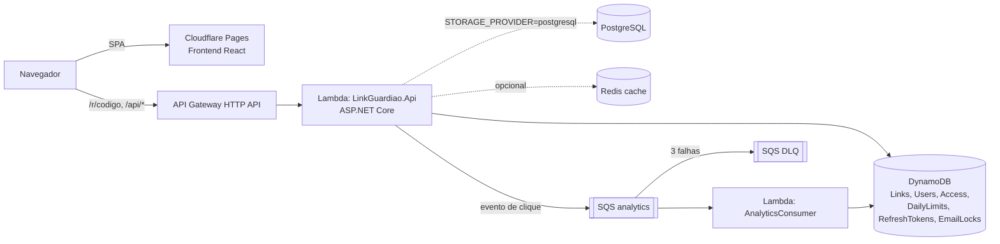

# LinkGuardiao

Encurtador de URLs com autenticação JWT, links protegidos por senha, expiração e estatísticas de clique.
O backend é uma API ASP.NET Core 8 empacotada para AWS Lambda (API Gateway HTTP API) com DynamoDB; há
uma implementação alternativa de persistência em PostgreSQL (EF Core). O frontend é React + Vite,
publicado no Cloudflare Pages pelo CI em push na `main`.

## O que o código faz

- Cadastro/login com JWT (access token curto + refresh token persistido e revogável).
- CRUD de links por usuário; código curto aleatório de 6 caracteres (nunca gera códigos reservados como `health`, `login`).
- Validação da URL de destino (ver [Segurança de URL](#segurança-de-url-de-destino)).
- Links com senha: o frontend troca a senha por um *access grant* (JWT de 60 s) e o redirect é feito pela API.
- Redirect `GET /r/{codigo}` e `GET /{codigo}` (6 caracteres) com `302`; cliques são enfileirados (SQS) e
  gravados por um consumer Lambda com deduplicação por id do evento.
- Rate limiting por usuário/IP (global e por endpoint), headers de segurança, health checks em `/health`, `/health/live`, `/health/ready`.
- Cache de leitura opcional via Redis (`REDIS_CONNECTION_STRING`).

## Arquitetura



Camadas do backend:

| Projeto | Papel |
|---|---|
| `src/LinkGuardiao.Api` | Controllers, middleware, rate limiting, health checks, entrada Lambda |
| `src/LinkGuardiao.Application` | Entidades, DTOs, serviços, validadores, políticas de segurança (`Security/`) |
| `src/LinkGuardiao.Infrastructure` | DynamoDB, SQS, cache, JWT, hash PBKDF2 |
| `src/LinkGuardiao.Infrastructure.PostgreSQL` | EF Core + migrations (alternativa ao DynamoDB) |
| `src/LinkGuardiao.AnalyticsConsumer` | Lambda consumidora da fila de analytics |
| `Frontend` | SPA React + Vite + Tailwind |
| `infra/cdk` | Infraestrutura AWS (CDK TypeScript) |

Decisões registradas em [`docs/adr`](docs/adr).

## Como rodar

### Local (dotnet + dependências no Docker)

```bash
cp .env.example .env            # ajuste JWT__SECRET (>= 32 caracteres)
docker compose up -d            # postgres, dynamodb-local, redis
pwsh ./scripts/local/init-dynamodb.ps1   # cria as tabelas no DynamoDB Local
dotnet run --project src/LinkGuardiao.Api
```

Para usar PostgreSQL em vez de DynamoDB, defina `STORAGE_PROVIDER=postgresql` e aplique as migrations:

```bash
dotnet ef database update --project src/LinkGuardiao.Infrastructure.PostgreSQL --startup-project src/LinkGuardiao.Infrastructure.PostgreSQL
```

Frontend:

```bash
cd Frontend
npm ci
cp .env.example .env
npm run dev                      # http://localhost:5173
```

### API no Docker Compose

O serviço `api` fica no profile `app` e usa PostgreSQL:

```bash
cp .env.example .env             # defina JWT__SECRET
docker compose up -d postgres redis
dotnet ef database update --project src/LinkGuardiao.Infrastructure.PostgreSQL --startup-project src/LinkGuardiao.Infrastructure.PostgreSQL
docker compose --profile app up -d --build
curl http://localhost:5000/health/live
```

A imagem (`src/LinkGuardiao.Api/Dockerfile`) é para desenvolvimento local; o deploy de produção é Lambda.
A API não aplica migrations sozinha.

## Variáveis de ambiente (backend)

| Variável | Obrigatória | Descrição |
|---|---|---|
| `JWT__SECRET` | sim | Chave HMAC do JWT, mínimo 32 caracteres |
| `JWT__ISSUER` / `JWT__AUDIENCE` | não | Issuer/audience do JWT (padrão `LinkGuardiao`) |
| `JWT__ACCESSTOKENMINUTES` | não | Validade do access token (5–120) |
| `CORS_ALLOWED_ORIGIN` | fora de Development | Origem permitida (ex.: domínio do Pages) |
| `STORAGE_PROVIDER` | não | `dynamodb` (padrão) ou `postgresql` |
| `POSTGRESQL_CONNECTION_STRING` | se `postgresql` | Connection string Npgsql |
| `AWS_REGION` | DynamoDB/SQS | Região AWS |
| `DDB_TABLE_LINKS`, `DDB_TABLE_USERS`, `DDB_TABLE_ACCESS`, `DDB_TABLE_DAILY_LIMITS`, `DDB_TABLE_REFRESH_TOKENS`, `DDB_TABLE_EMAIL_LOCKS` | DynamoDB | Nomes das tabelas |
| `DDB_SERVICE_URL` | não | Endpoint do DynamoDB Local (ex.: `http://localhost:8000`) |
| `SQS_ANALYTICS_QUEUE_URL` | não | Se vazio, os cliques não são enfileirados (`NoOpAnalyticsQueue`) |
| `REDIS_CONNECTION_STRING` | não | Habilita cache distribuído de leitura |
| `LINKLIMITS__DAILYUSERCREATELIMIT` | não | Limite diário de criação de links por usuário (padrão 100) |
| `POSTGRES_PASSWORD` | não | Senha do Postgres local do `docker compose` |

Frontend: `VITE_API_BASE_URL` (URL base da API, sem `/api`).

## Segurança de URL de destino

Implementado em `src/LinkGuardiao.Application/Security/UrlSafety.cs` e `IpAddressPolicy.cs`, aplicado na
criação/edição (validador + serviço) e de novo no momento do redirect:

- Apenas `http`/`https`; `javascript:`, `data:`, `file:`, `ftp:`, `gopher:` etc. são rejeitados.
- Sem credenciais na URL (`user@host`, `https://confiavel.com@malicioso.com`).
- Sem caracteres de controle (CR/LF/TAB/NUL) nem `\`; máximo de 2048 caracteres.
- Host IDN convertido para punycode; a URL é persistida e enviada no `Location` em forma ASCII canônica.
- Hosts internos rejeitados: `localhost`, `*.localhost`, `*.local`, `*.localdomain`, `*.internal`, `*.home.arpa`, `*.arpa` e nomes de rótulo único.
- IPs não públicos rejeitados (loopback, RFC 1918, 169.254/16 incl. metadata, 100.64/10, 0/8, multicast,
  reservados, documentação, `::1`, `fc00::/7`, `fe80::/10`, NAT64, 6to4, Teredo), inclusive em formas
  alternativas que navegadores aceitam: `2130706433`, `0x7f000001`, `127.1`, `0177.0.0.1`, `127.0.0.1.`,
  dígitos fullwidth e `[::ffff:127.0.0.1]`.
- Link legado que não passa mais na validação responde `410` sem registrar clique.
- Rotas públicas (`/r/{codigo}`, `/api/links/code/{codigo}`, access-grant) rejeitam códigos fora de `[A-Za-z0-9_-]{1,32}`.

O backend **não faz requisições HTTP para as URLs dos usuários** (sem preview, crawler ou webhook), então
não há superfície de SSRF no servidor hoje. Ver ADR 0002 para os requisitos de qualquer funcionalidade futura que precise buscar URLs.

## Testes

```bash
dotnet build LinkGuardiao.sln -c Release
dotnet test LinkGuardiao.sln -c Release
# PostgreSQL via Testcontainers (requer Docker e acesso ao Docker Hub):
RUN_POSTGRESQL_TESTCONTAINERS=true dotnet test tests/LinkGuardiao.Infrastructure.PostgreSQL.Tests -c Release

cd Frontend && npm ci && npm run lint && npm run test:run && npm run build
```

- `tests/LinkGuardiao.Application.Tests`: serviços e políticas de URL/código curto (inclui as representações alternativas de IP).
- `tests/LinkGuardiao.Api.Tests`: fluxo HTTP completo com `WebApplicationFactory` e repositórios em memória (sem AWS).
- `tests/LinkGuardiao.Infrastructure.PostgreSQL.Tests`: repositórios EF (InMemory) e integração com PostgreSQL real (pulados sem `RUN_POSTGRESQL_TESTCONTAINERS=true`).

## CI/CD

- `.github/workflows/ci.yml`: em `pull_request` e push na `main` — restore, scan de pacotes vulneráveis,
  build Release, testes .NET com limiar mínimo de cobertura de linhas (30% Application/API, 15% PostgreSQL),
  lint/testes/build do frontend, `npm audit`, publish do artefato Lambda e `cdk synth`. O passo
  "Deploy to Cloudflare Pages" só roda em push na `main`.
- `.github/workflows/deploy.yml`: deploy AWS manual (`workflow_dispatch`) com OIDC.

Deploy AWS manual: ver [`docs/DEPLOY_AWS.md`](docs/DEPLOY_AWS.md) e `scripts/aws/*.ps1`.
Frontend: [`docs/DEPLOY_CLOUDFLARE_PAGES.md`](docs/DEPLOY_CLOUDFLARE_PAGES.md). Desenvolvimento local: [`docs/local-dev.md`](docs/local-dev.md).

## Limitações conhecidas / não implementado

- Não há verificação de DNS do destino: um domínio público que resolve para IP privado (ex.: serviços do tipo `127.0.0.1.nip.io`) é aceito. Como o servidor não busca a URL, o impacto é apenas no navegador de quem clica.
- Não há checagem de reputação/malware dos destinos nem bloqueio de homógrafos (o host é apenas normalizado para punycode).
- Não há aliases personalizados: os códigos são sempre aleatórios.
- A API não aplica migrations do PostgreSQL automaticamente.
- O build Docker não foi validado de ponta a ponta neste ambiente (restore NuGet indisponível dentro do container de build); o estágio de runtime foi validado com um publish local.
- A validação de IDN depende de ICU (`InvariantGlobalization=false`).
